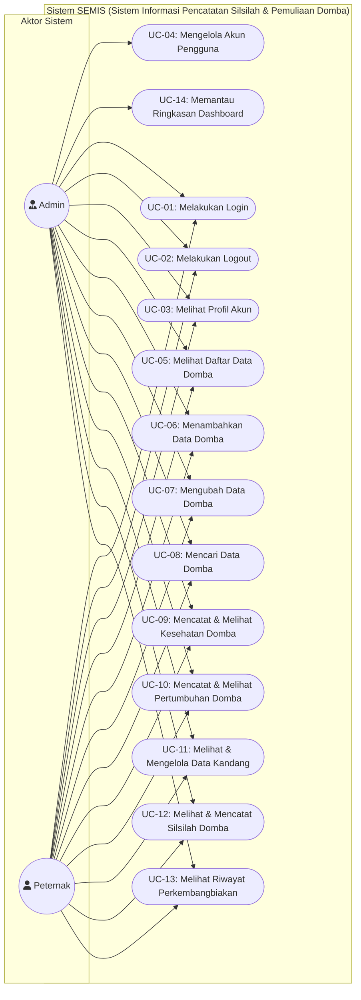
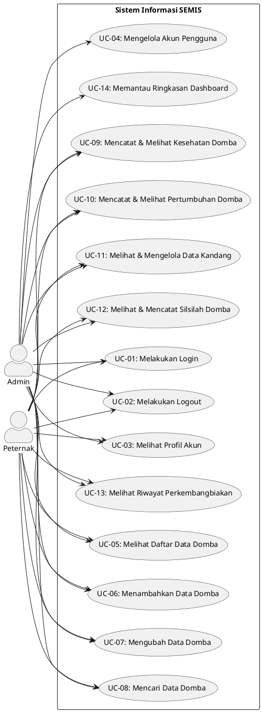

# 📄 Analisis & Perancangan Use Case — SEMIS
**Sistem Informasi Pencatatan Silsilah dan Pemuliaan Domba Terintegrasi**

Dokumen ini disusun berdasarkan **Tabel 3.1: Tabel Kebutuhan Fungsional** untuk keperluan dokumentasi rekayasa perangkat lunak / laporan tugas akhir (Bab 3).

---

## 1. Definisi Aktor

Berdasarkan Tabel Kebutuhan Fungsional, terdapat 2 (dua) aktor yang berinteraksi dengan sistem SEMIS:

| No | Aktor | Deskripsi Peran | Hak Akses |
|:--:|:---|:---|:---|
| 1 | **Admin** | Pengelola sistem utama yang memiliki hak akses penuh terhadap seluruh fitur aplikasi, termasuk manajemen pengguna dan pemantauan ringkasan peternakan tingkat manajerial. | FR-01 s/d FR-14 (Akses Penuh) |
| 2 | **Peternak** | Pengguna operasional di lapangan yang bertugas mencatat dan memantau data domba, kandang, kesehatan, pertumbuhan, silsilah, serta perkembangbiakan. | FR-01, FR-02, FR-03, FR-05 s/d FR-13 |

---

## 2. Pemetaan Kebutuhan Fungsional ke Use Case

| Kode FR | Kode UC | Nama Use Case | Aktor Terlibat | Keterangan |
|:--:|:--:|:---|:---|:---|
| **FR-01** | UC-01 | Melakukan Login | Admin, Peternak | Pengguna dapat masuk ke aplikasi menggunakan akun Google / sesi tersimpan. |
| **FR-02** | UC-02 | Melakukan Logout | Admin, Peternak | Pengguna dapat keluar dari sesi aplikasi secara aman. |
| **FR-03** | UC-03 | Melihat Profil Akun | Admin, Peternak | Pengguna dapat melihat identitas, email, dan detail akun yang sedang aktif. |
| **FR-04** | UC-04 | Mengelola Akun Pengguna | Admin | Admin dapat melihat, menambah, mengubah hak akses, atau menonaktifkan akun peternak. |
| **FR-05** | UC-05 | Melihat Daftar Data Domba | Admin, Peternak | Pengguna dapat melihat katalog/list seluruh domba beserta statusnya. |
| **FR-06** | UC-06 | Menambahkan Data Domba | Admin, Peternak | Pengguna dapat mendaftarkan domba baru beserta identitas dan jenis kelaminnya. |
| **FR-07** | UC-07 | Mengubah Data Domba | Admin, Peternak | Pengguna dapat memperbarui rincian informasi dan status domba. |
| **FR-08** | UC-08 | Mencari Data Domba | Admin, Peternak | Pengguna dapat memfilter dan mencari domba berdasarkan ID, nama, jenis, atau status. |
| **FR-09** | UC-09 | Mencatat & Melihat Kesehatan Domba | Admin, Peternak | Pengguna dapat melihat status kesehatan serta mencatat diagnosis, obat, atau riwayat sakit. |
| **FR-10** | UC-10 | Mencatat & Melihat Pertumbuhan Domba | Admin, Peternak | Pengguna dapat mencatat dan memantau perkembangan bobot/fisik domba secara berkala. |
| **FR-11** | UC-11 | Melihat & Mengelola Data Kandang | Admin, Peternak | Pengguna dapat melihat daftar kandang, kapasitas, serta mengatur penempatan domba. |
| **FR-12** | UC-12 | Melihat & Mencatat Silsilah Domba | Admin, Peternak | Pengguna dapat menghubungkan dan melihat relasi silsilah (induk jantan / sire & betina / dam). |
| **FR-13** | UC-13 | Melihat Riwayat Perkembangbiakan | Admin, Peternak | Pengguna dapat menelusuri catatan pemuliaan/breeding dan keturunan domba. |
| **FR-14** | UC-14 | Memantau Ringkasan Dashboard | Admin | Admin dapat memantau ringkasan statistik total populasi, status kesehatan, dan kandang. |

---

## 3. Use Case Diagram

### 3.1 Visual Diagram (Mermaid)

### 3.2 Source Code PlantUML (Siap di-render di PlantUML / Draw.io / StarUML)

---

## 4. Skenario Use Case Lengkap (UC-01 s/d UC-14)

### UC-01: Melakukan Login
* **Kode FR**: FR-01
* **Aktor**: Admin, Peternak
* **Deskripsi**: Pengguna melakukan proses autentikasi untuk masuk dan mengakses fitur aplikasi.
* **Kondisi Awal (Pre-condition)**: Aplikasi terpasang dan pengguna berada di halaman login.
* **Kondisi Akhir (Post-condition)**: Pengguna terautentikasi dan diarahkan ke halaman utama/dashboard.
* **Alur Utama (Main Flow)**:
  1. Pengguna membuka aplikasi dan menekan tombol *Sign in with Google*.
  2. Sistem menampilkan dialog pemilihan akun Google dan permintaan izin akses (*OAuth scopes*).
  3. Pengguna memilih akun yang terdaftar dan menyetujui izin akses.
  4. Sistem memverifikasi kredensial akun dan menyiapkan sesi aktif pengguna.
  5. Sistem mengarahkan pengguna ke halaman utama.
* **Alur Alternatif (Alternative Flow)**:
  * **2a. Perangkat Offline (Sesi Lokal Tersedia)**: Pengguna membuka aplikasi saat offline; sistem memverifikasi cache sesi terakhir dan langsung mengizinkan masuk dalam mode offline.
  * **3a. Izin Akses Ditolak**: Pengguna menolak izin akses Google Drive; sistem menampilkan notifikasi kesalahan dan tetap berada di halaman login.

---

### UC-02: Melakukan Logout
* **Kode FR**: FR-02
* **Aktor**: Admin, Peternak
* **Deskripsi**: Pengguna mengakhiri sesi aktif aplikasi.
* **Kondisi Awal (Pre-condition)**: Pengguna dalam status login.
* **Kondisi Akhir (Post-condition)**: Sesi pengguna dihapus dari memori dan pengguna diarahkan ke halaman login.
* **Alur Utama (Main Flow)**:
  1. Pengguna membuka menu Profil.
  2. Pengguna menekan tombol "Logout / Keluar".
  3. Sistem menampilkan dialog konfirmasi keluar.
  4. Pengguna menyetujui konfirmasi.
  5. Sistem menghapus sesi autentikasi dan mengembalikan tampilan ke halaman Login.
* **Alur Alternatif (Alternative Flow)**:
  * **4a. Pengguna Membatalkan**: Pengguna menekan tombol "Batal"; sistem menutup dialog dan pengguna tetap berada di menu Profil.

---

### UC-03: Melihat Profil Akun
* **Kode FR**: FR-03
* **Aktor**: Admin, Peternak
* **Deskripsi**: Pengguna melihat informasi profil akun yang sedang login beserta status koneksi dan sinkronisasi.
* **Kondisi Awal (Pre-condition)**: Pengguna sudah login.
* **Kondisi Akhir (Post-condition)**: Informasi profil pengguna ditampilkan di layar.
* **Alur Utama (Main Flow)**:
  1. Pengguna menekan ikon/menu "Profil" pada navigasi bawah.
  2. Sistem mengambil data akun pengguna (nama, email, foto, peran, status sinkronisasi).
  3. Sistem merender halaman profil dengan informasi akun terkini.
* **Alur Alternatif (Alternative Flow)**:
  * **2a. Mode Offline**: Sistem menampilkan profil berdasarkan data cache lokal dengan indikator status *"Offline"*.

---

### UC-04: Mengelola Akun Pengguna
* **Kode FR**: FR-04
* **Aktor**: Admin
* **Deskripsi**: Admin mengelola daftar akun pengguna (menambah, mengubah peran peternak/admin, mengaktifkan/menonaktifkan akun).
* **Kondisi Awal (Pre-condition)**: Admin telah login dengan hak akses administrator.
* **Kondisi Akhir (Post-condition)**: Data akun pengguna tersimpan atau diperbarui pada database.
* **Alur Utama (Main Flow)**:
  1. Admin membuka menu Manajemen Akun Pengguna.
  2. Sistem menampilkan daftar akun pengguna terdaftar.
  3. Admin memilih aksi (tambah akun / ubah status / ubah peran pengguna).
  4. Admin memasukkan/memperbarui data akun lalu menekan "Simpan".
  5. Sistem memvalidasi input, memperbarui database, dan menampilkan notifikasi berhasil.
* **Alur Alternatif (Alternative Flow)**:
  * **4a. Data Tidak Valid**: Admin mengosongkan data wajib; sistem memunculkan pesan peringatan validasi form.

---

### UC-05: Melihat Daftar Data Domba
* **Kode FR**: FR-05
* **Aktor**: Admin, Peternak
* **Deskripsi**: Pengguna melihat katalog daftar ternak domba yang terdata di sistem.
* **Kondisi Awal (Pre-condition)**: Pengguna telah login.
* **Kondisi Akhir (Post-condition)**: Daftar domba ditampilkan secara terurut dengan ringkasan status masing-masing.
* **Alur Utama (Main Flow)**:
  1. Pengguna mengakses menu "Data Domba".
  2. Sistem membaca data ternak dari database lokal / cloud.
  3. Sistem menyajikan daftar kartu domba (ID/Tag, Nama, Jenis Kelamin, Umur, Status Kesehatan).
* **Alur Alternatif (Alternative Flow)**:
  * **2a. Data Kosong**: Jika belum ada data ternak, sistem menampilkan ilustrasi dan pesan *"Belum ada data domba"*.

---

### UC-06: Menambahkan Data Domba
* **Kode FR**: FR-06
* **Aktor**: Admin, Peternak
* **Deskripsi**: Pengguna mendaftarkan entitas domba baru ke dalam sistem.
* **Kondisi Awal (Pre-condition)**: Pengguna berada di halaman Data Domba.
* **Kondisi Akhir (Post-condition)**: Domba baru berhasil tersimpan di database lokal dan disiapkan untuk sinkronisasi.
* **Alur Utama (Main Flow)**:
  1. Pengguna menekan tombol tambah (+) "Tambah Domba".
  2. Sistem menampilkan form isian data domba (Nomor Tag/ID, Nama, Ras, Tanggal Lahir, Jenis Kelamin, Kandang, Status).
  3. Pengguna mengisi informasi formulir dan menekan "Simpan".
  4. Sistem memvalidasi keunikan ID dan kelengkapan field.
  5. Sistem menyimpan data ke database lokal dan memberikan pesan sukses.
* **Alur Alternatif (Alternative Flow)**:
  * **4a. ID Duplikat atau Field Kosong**: Sistem menolak penyimpanan dan menampilkan peringatan field yang bermasalah.

---

### UC-07: Mengubah Data Domba
* **Kode FR**: FR-07
* **Aktor**: Admin, Peternak
* **Deskripsi**: Pengguna memperbarui informasi domba yang sudah ada sebelumnya.
* **Kondisi Awal (Pre-condition)**: Pengguna memilih salah satu domba dari daftar.
* **Kondisi Akhir (Post-condition)**: Data perubahan domba tersimpan dan terbarui di daftar.
* **Alur Utama (Main Flow)**:
  1. Pengguna memilih data domba yang ingin diubah, lalu menekan tombol "Edit".
  2. Sistem memuat rincian data lama ke dalam form formulir edit.
  3. Pengguna mengubah data yang diinginkan dan menekan "Perbarui".
  4. Sistem memvalidasi perubahan dan menyimpannya ke database.
  5. Sistem menampilkan pesan sukses dan kembali ke tampilan daftar/detail domba.
* **Alur Alternatif (Alternative Flow)**:
  * **3a. Pengguna Membatalkan**: Pengguna menekan tombol kembali/batal; perubahan dibatalkan tanpa tersimpan.

---

### UC-08: Mencari Data Domba
* **Kode FR**: FR-08
* **Aktor**: Admin, Peternak
* **Deskripsi**: Pengguna melakukan pencarian dan penyaringan data domba secara cepat.
* **Kondisi Awal (Pre-condition)**: Pengguna berada di halaman Data Domba.
* **Kondisi Akhir (Post-condition)**: Daftar domba yang ditampilkan terfilter sesuai kriteria pencarian.
* **Alur Utama (Main Flow)**:
  1. Pengguna mengetikkan kata kunci (ID, Tag, atau Nama) pada bilah pencarian atau memilih filter status.
  2. Sistem melakukan pencarian realtime pada database lokal.
  3. Sistem menyajikan hasil domba yang cocok dengan kata kunci pencarian.
* **Alur Alternatif (Alternative Flow)**:
  * **2a. Tidak Ditemukan**: Sistem menampilkan pesan *"Data domba tidak ditemukan"*.

---

### UC-09: Mencatat dan Melihat Kesehatan Domba
* **Kode FR**: FR-09
* **Aktor**: Admin, Peternak
* **Deskripsi**: Pengguna memeriksa riwayat rekam medis dan mencatat kondisi kesehatan/vaksinasi domba.
* **Kondisi Awal (Pre-condition)**: Pengguna berada di menu kesehatan atau detail domba.
* **Kondisi Akhir (Post-condition)**: Catatan kesehatan baru tersimpan dan status domba terbarui (misal: Sehat/Sakit/Karantina).
* **Alur Utama (Main Flow)**:
  1. Pengguna memilih domba yang bersangkutan dan masuk ke tab "Kesehatan".
  2. Sistem menampilkan histori pemeriksaan kesehatan sebelumnya.
  3. Pengguna menekan "Catat Pemeriksaan", mengisi status kesehatan, gejala, diagnosis, atau obat yang diberikan.
  4. Pengguna menekan "Simpan".
  5. Sistem menyimpan log kesehatan dan memperbarui status kondisi domba.
* **Alur Alternatif (Alternative Flow)**:
  * **3a. Form Kosong**: Jika diagnosis/kondisi belum dipilih, sistem meminta pengguna melengkapi input wajib.

---

### UC-10: Mencatat dan Melihat Pertumbuhan Domba
* **Kode FR**: FR-10
* **Aktor**: Admin, Peternak
* **Deskripsi**: Pengguna mencatat metrik pertumbuhan fisik domba (bobot badan, tinggi gumba, lingkar dada) serta melihat grafik perkembangannya.
* **Kondisi Awal (Pre-condition)**: Pengguna berada pada halaman detail pertumbuhan domba.
* **Kondisi Akhir (Post-condition)**: Catatan pertumbuhan baru tersimpan dalam histori pengukuran.
* **Alur Utama (Main Flow)**:
  1. Pengguna membuka tab "Pertumbuhan" pada domba yang dipilih.
  2. Sistem menampilkan log penimbangan dan grafik pertambahan berat badan harian/bulanan.
  3. Pengguna menekan "Tambah Catatan Penimbangan" dan menginputkan bobot terbaru (kg) serta tanggal timbang.
  4. Pengguna menekan "Simpan".
  5. Sistem memvalidasi bahwa nilai bobot bernilai positif (> 0) dan menyimpannya.
* **Alur Alternatif (Alternative Flow)**:
  * **4a. Nilai Bobot Negatif/Nol**: Sistem memunculkan validasi *"Berat badan harus bernilai positif"*.

---

### UC-11: Melihat dan Mengelola Data Kandang
* **Kode FR**: FR-11
* **Aktor**: Admin, Peternak
* **Deskripsi**: Pengguna melihat pembagian blok kandang, kapasitas keterisian, serta menambah atau memindahkan domba antar kandang.
* **Kondisi Awal (Pre-condition)**: Pengguna telah login ke aplikasi.
* **Kondisi Akhir (Post-condition)**: Data kandang dan alokasi domba di dalamnya tersimpan rapi.
* **Alur Utama (Main Flow)**:
  1. Pengguna mengakses menu "Kandang".
  2. Sistem menampilkan daftar kandang beserta rasio keterisian (contoh: 8/10 ekor).
  3. Pengguna dapat memilih kandang untuk melihat daftar domba penghuninya atau menekan "Tambah/Kelola Kandang".
  4. Pengguna menyimpan konfigurasi kandang atau alokasi domba.
  5. Sistem memperbarui database kandang.
* **Alur Alternatif (Alternative Flow)**:
  * **4a. Kandang Penuh**: Jika kapasitas maksimal tercapai, sistem memunculkan peringatan *"Kapasitas kandang telah penuh"*.

---

### UC-12: Melihat dan Mencatat Silsilah Domba
* **Kode FR**: FR-12
* **Aktor**: Admin, Peternak
* **Deskripsi**: Pengguna mencatat dan melihat silsilah garis keturunan (Induk Jantan/Sire dan Induk Betina/Dam).
* **Kondisi Awal (Pre-condition)**: Data domba induk sudah terdaftar di sistem.
* **Kondisi Akhir (Post-condition)**: Relasi silsilah terhubung dan diagram pohon silsilah dapat divisualisasikan.
* **Alur Utama (Main Flow)**:
  1. Pengguna membuka menu "Silsilah" pada profil domba tertentu.
  2. Sistem merender visualisasi silsilah (Ayah, Ibu, dan Kakek-Nenek).
  3. Pengguna menekan "Ubah Silsilah" untuk menautkan ID pejantan dan ID betina sebagai indukan.
  4. Pengguna menekan "Simpan".
  5. Sistem memvalidasi logika relasi (umur induk lebih tua dari anak, domba tidak menjadi induk bagi dirinya sendiri).
  6. Sistem menyimpan relasi silsilah.
* **Alur Alternatif (Alternative Flow)**:
  * **5a. Hubungan Silsilah Tidak Logis**: Sistem menolak dan memunculkan error *"Induk tidak boleh sama dengan anak atau memiliki umur lebih muda"*.

---

### UC-13: Melihat Riwayat Perkembangbiakan Domba
* **Kode FR**: FR-13
* **Aktor**: Admin, Peternak
* **Deskripsi**: Pengguna melihat riwayat proses perkawinan/pemuliaan (*breeding*), perkiraan waktu melahirkan, serta daftar anakan yang dihasilkan.
* **Kondisi Awal (Pre-condition)**: Pengguna mengakses menu Riwayat Pemuliaan (*Breeding*).
* **Kondisi Akhir (Post-condition)**: Riwayat perkembangbiakan ditampilkan secara kronologis.
* **Alur Utama (Main Flow)**:
  1. Pengguna membuka menu "Pemuliaan / Breeding".
  2. Sistem menampilkan kartu riwayat perkembangbiakan (tanggal kawin, pejantan, betina, status kebuntingan, tanggal kelahiran anak).
  3. Pengguna dapat memilih salah satu riwayat untuk melihat rincian keturunan yang dilahirkan.
* **Alur Alternatif (Alternative Flow)**:
  * **2a. Belum Ada Riwayat**: Sistem menampilkan status *"Belum ada riwayat perkembangbiakan"*.

---

### UC-14: Memantau Ringkasan Data Ternak melalui Dashboard
* **Kode FR**: FR-14
* **Aktor**: Admin
* **Deskripsi**: Admin memantau rekapitulasi data peternakan secara komprehensif dari layar dasbor utama.
* **Kondisi Awal (Pre-condition)**: Admin telah login dengan hak akses administrator.
* **Kondisi Akhir (Post-condition)**: Dashboard menyajikan statistik metrik peternakan terkini.
* **Alur Utama (Main Flow)**:
  1. Admin membuka halaman utama / Dashboard.
  2. Sistem menghitung statistik dari database (total domba, jumlah jantan/betina, domba sakit, keterisian kandang, dan status sinkronisasi).
  3. Sistem menyajikan ringkasan visual berupa kartu metrik (*summary cards*) dan grafik analitik peternakan.
* **Alur Alternatif (Alternative Flow)**:
  * **2a. Sinkronisasi Belum Selesai**: Sistem menyajikan data lokal disertai label status *"Sinkronisasi sedang berlangsung"*.
